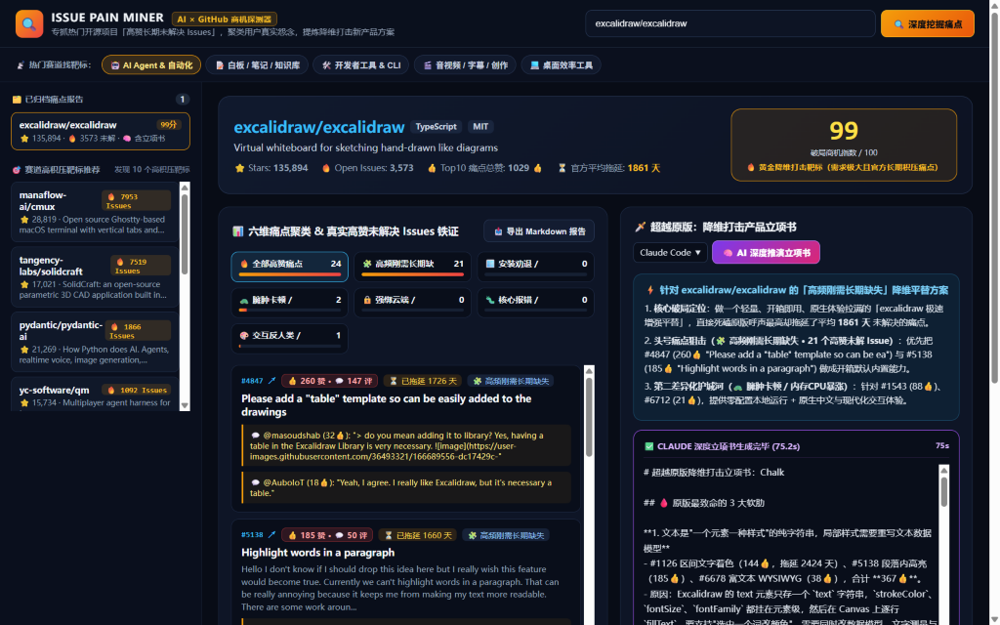

<p align="center">
  
</p>

# Issue Pain Miner 🔍🗡️（GitHub 竞品痛点挖掘机 & AI 降维复刻工作台）

**从热门开源项目「用户骂得最凶、点赞最高却几年不修」的 Issues 里，精准挖出你的下一个爆款产品！**

做独立开发或开源项目最怕“自嗨造轮子”。**Issue Pain Miner** 直接利用你本机的 `gh` (GitHub CLI) 与本地 AI 编程引擎（`Claude Code` / `OpenAI Codex`），3 秒拉取任意热门仓库**最高赞（👍）与最高讨论（💬）的未解决 Open Issues + 真实用户吐槽原话**，自动聚类六大破局维度并生成一份可直接开工的 **《超越原版降维打击立项书 (Giant-Killer PRD)》**！

---

## 核心实战能力

1. **📡 热门赛道高积压靶标雷达**：内置 `AI Agent`、`白板/笔记`、`开发者 CLI`、`音视频创作`、`桌面效率` 五大高潜赛道扫描器，一键揪出 **Star 高但未解决 Issues 堆积如山** 的可乘之机靶标！
2. **🎯 破局商机指数 (`0–100`) & 六维痛点聚类**：
   - 综合市场热度、积压规模、Top10 痛点总赞数与**官方平均拖延天数**量化评分；
   - 自动聚类为 **🧩 高频刚需缺失、🪟 安装/Windows劝退、🐢 臃肿卡顿、🔒 强绑云端/收费墙、🐛 崩溃硬伤、🎨 交互/中文痛点** 六大尖刀切入方向，并抓取高赞评论原话作为立项铁证！
3. **🧠 本地 `Claude / Codex` 产品总监深度推演**：实时流式调用本地 CLI 撰写《降维打击立项书》，输出原版 3 大软肋、新产品尖刀定位、3 天 MVP 技术栈与**一键建库开工 Prompt**！
4. **⚡ 一键联动 `Pocket Foreman` 自动建库开写**：支持一键把生成的超越方案直接派单给本地 `Pocket Foreman` 调度多智能体开工，或导出完整 Markdown 调研报告！
5. **🤖 跨平台 Agent Skill (`$issue-pain-miner`)**：自带 `SKILL.md` 与 CLI，在终端或任意 AI 编程助手里一句话即可调用。

---

## 快速使用

```bash
# 1. 启动可视化商机挖掘工作台 (默认 http://127.0.0.1:4795/)
npm start

# 2. 命令行极速深挖任意仓库 (+ 可选调用本地 Claude 生成立项书)
node bin/pain-miner.mjs analyze excalidraw/excalidraw --ai claude

# 3. 运行自动化测试
npm test
```

## License

MIT © dyc19991225
